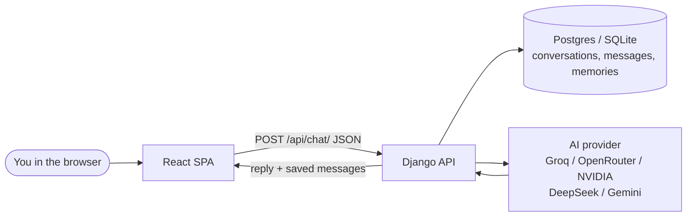

# KAI v2 — my personal AI assistant (Django + React)

[](https://kai-ai-02i0.onrender.com)
[](https://github.com/pawanriko/Kai-AI)


[](https://skillicons.dev)

The first version of KAI was a single `index.html` file. The browser kept the Groq API key, talked to Groq directly, and the "memory" lived in localStorage — so it forgot everything the day I cleared my browser data. It worked, but it wasn't a real app.

So I rebuilt it properly. v2 is a full-stack app:

- A **Django backend** keeps the API keys on the server (in a `.env` file, never in git, never in the browser), talks to the AI providers, and stores everything in a database.
- A **React frontend** which is just the face — it sends JSON to Django and shows what comes back.
- **Memory that actually lasts**: conversations and messages are database rows. After every exchange, KAI pulls out facts about me (my college, my projects, things like that) and saves them in a `Memory` table as *suggestions* — a fact only reaches future prompts after I confirm it in the Memory panel, and I can reject or forget facts there too.

**Live:** [kai-ai-02i0.onrender.com](https://kai-ai-02i0.onrender.com) (Render free tier — it sleeps when idle, so the first open can take a moment).

## How it fits together



What happens when I send one message: React POSTs to `/api/chat/` → Django loads that conversation's history from the DB → puts together the message list the AI APIs expect → adds a system prompt carrying my stored facts → calls the provider → saves both messages → extracts any new facts → sends the reply back to React.

## Project map

```
kai-v2/
├── manage.py                 Django's command tool
├── requirements.txt          Django + python-dotenv (pinned)
├── .env.example              template for the secrets file (copy to .env)
├── config/                   project settings + master URL map
├── chat/                     the app that is KAI
│   ├── models.py             Conversation / Message / Memory tables
│   ├── ai.py                 the ONLY module that talks to Groq/Gemini
│   ├── router.py             smart model routing (Auto + coding picks)
│   ├── agent.py / tools.py   agent-mode tools (calculator, datetime, weather)
│   ├── polish.py             prompt-polisher endpoint
│   ├── research.py           web research with citations
│   ├── views.py              the API endpoints
│   ├── urls.py               /api/ route table
│   ├── ratelimit.py          per-IP fixed-window rate limiting
│   └── tests.py              219 backend tests, AI + tools mocked (no network)
├── docs/                     architecture + security/feature audits
└── frontend/                 Vite + React
    └── src/
        ├── api.js            every backend call in one place
        ├── App.jsx           state conductor
        └── components/       Login, Sidebar, MessageList, ChatInput, MemoryPanel,
                              UsagePanel, PlanReview, AutomationPanel
```

## API

Everything except `/api/ping/` and the auth endpoints requires a
logged-in session (Phase 1), and every POST/DELETE requires a CSRF
token. KAI has exactly one owner: on a fresh install the login screen
offers a one-time setup (`POST /api/auth/setup/`) that creates the
owner account and then closes forever — and it demands the
deployment-only bootstrap token (`KAI_SETUP_TOKEN` in the server's
environment), so a random visitor can never claim a fresh
deployment. Locally, `python manage.py createsuperuser` works too.
Once any user exists, setup is closed for good: restoring or
re-setting `KAI_SETUP_TOKEN` later does **not** reopen it, and
removing the token simply disables the (already closed) web setup
endpoint.

Rate limits are per-IP fixed windows (chat 30/min, login 10/5 min,
setup 5/5 min) kept in the process's local memory cache. That is
correct for the single free instance; it is **not** suitable for
multi-worker scaling — counters would diverge per worker. Running
several workers requires a shared cache backend such as Redis
(`CACHES` in settings), which is not configured today.

| Method | Path | What |
|---|---|---|
| GET | `/api/ping/` | health check (public) |
| GET | `/api/auth/me/` | session state; also plants the CSRF cookie |
| POST | `/api/auth/setup/` | create the owner (only while zero users exist) |
| POST | `/api/auth/login/` · `/api/auth/logout/` | session in/out |
| GET | `/api/models/` | provider + model catalogue for the picker |
| POST | `/api/chat/` | `{message, conversation_id?, model?, agent?, coding?, confirm_commands?}` → `{reply, conversation_id, trace}` |
| POST | `/api/chat/stream/` | same body (plain chat only) → NDJSON stream of `{type: "chunk", text}` events, ending with `{type: "done", conversation_id}`; if the provider fails mid-reply, an `{type: "error", interrupted: true}` event instead — the partial reply is saved flagged `incomplete`, labelled in the UI, and kept out of future AI context |
| GET | `/api/conversations/` | list conversations |
| GET | `/api/conversations/<id>/` | conversation + messages |
| DELETE | `/api/conversations/<id>/delete/` | delete conversation |
| GET | `/api/memories/` | list stored facts, each with a `status` |
| POST | `/api/memories/<id>/confirm/` · `/reject/` | approve / drop a suggested fact |
| DELETE | `/api/memories/<id>/delete/` | forget one fact |

## Run it locally

Backend (terminal 1):

```powershell
python -m venv .venv
.venv\Scripts\Activate.ps1
pip install -r requirements.txt
Copy-Item .env.example .env    # then put your GROQ_API_KEY in .env
python manage.py migrate
python manage.py runserver
```

Frontend (terminal 2):

```powershell
cd frontend
npm install
npm run dev
```

Open http://localhost:5173 — the Vite dev server proxies `/api` calls to Django on :8000.

First open asks you to create the owner account (or log in) — KAI is
locked to everyone else. Tests: `python manage.py test` (219 backend
tests, no network needed) and `npm test` in `frontend/` (124 frontend tests for
the API client's auth/CSRF/setup/memory behaviour). Production
frontend build: `npm run build` in `frontend/`.

## Deploying to Render

The service is defined by `render.yaml` (build: install deps → build
the frontend → `collectstatic` → `migrate`; start: gunicorn), but
this service is deployed **manually** from the Render dashboard —
`render.yaml` alone does not change the running service, and
`sync: false` variables are never read from the repo. The order
matters:

1. **Dashboard → kai-ai → Environment** — make sure these exist
   *before* deploying the Phase 1 code:
   - `SECRET_KEY` (auto-generated by Render) and `DATABASE_URL`
     (the Neon connection string)
   - at least one provider key (`GEMINI_API_KEY`, `OPENROUTER_API_KEY`, …)
   - `KAI_PRODUCTION=1` — turns on the strict production settings
   - `KAI_SETUP_TOKEN` — a long random value you invent; without it
     web setup stays disabled and no owner can be created from the
     browser
2. **Manual Deploy** the latest commit.
3. Open the site: the setup screen asks for a username, a password
   and the `KAI_SETUP_TOKEN` from step 1. That creates the one owner
   account (and logs you in). Setup then closes permanently.
4. Optional tidy-up: remove `KAI_SETUP_TOKEN` from the dashboard —
   web setup is disabled without it, and it cannot create a second
   owner either way.

`KAI_CODING_ENABLED` must stay **unset** on Render: command
execution only ever runs on my own machine (see Coding mode below).

## Providers

In `ai.py` there's a registry of providers. A model is just a name; a provider is the service hosting it (base URL + key + format). Almost all of them speak the OpenAI chat-completions format, so one code path covers them; Gemini has its own adapter because its API is shaped differently.

| Provider | Key in `.env` | Models offered |
|---|---|---|
| Groq | `GROQ_API_KEY` | Llama 3.3 70B, GPT OSS 120B/20B, Llama 4 Scout, Qwen3 32B, Llama 3.1 8B |
| OpenRouter | `OPENROUTER_API_KEY` | Nemotron 3 Ultra 550B (free), Gemma 4 31B/26B (free), Nemotron 3.5 Lightning (free), Nemotron 3 Nano Reasoning (free), ERNIE 5.5 Flash (free), LFM 3 1.7B (free), Ling 3.2 Flash (free), Muse Ember, DeepSeek V3.2, Hy4, Mistral Large 4 |
| NVIDIA NIM | `NVIDIA_API_KEY` | Nemotron Super 49B, DeepSeek V4 Flash |
| DeepSeek | `DEEPSEEK_API_KEY` | DeepSeek Chat, DeepSeek Reasoner |
| Google Gemini | `GEMINI_API_KEY` | Gemini 3.8 Flash, Gemini 4 Hydrogen, Gemini 3.5 Flash-Lite |

The model picker in the UI is fed by `GET /api/models/`, and providers whose key I haven't set are greyed out. If the provider I pick fails or hits a rate limit, KAI quietly tries the other configured ones. If I want only one provider, I set `AI_PROVIDER=<name>` in `.env` and the fallback stops.

## Agent mode

There's an **Agent** toggle in the message box. With it on, KAI doesn't just answer — the model can use tools: a `calculator` (exact maths, run through a sandboxed expression parser), `current_datetime`, and `weather` (Open-Meteo, needs no key). It can call a tool, look at the result, and call another, up to 6 steps, before it replies. Every step it took is saved with the reply and shown under it ("Agent steps"), so I can see exactly what it did instead of trusting it blindly.

## Coding mode

The **Code** toggle makes KAI a coding agent with a bigger budget (14 steps). It works the way coding agents do: look around → edit → run the tests → read the failure → fix it. Its *file* tools (`list_files`, `read_file`, `write_file`, `edit_file`, `search_code`) are confined to one workspace folder: `agent_workspace/` in the project, or whatever `KAI_WORKSPACE` points to in `.env`. Every file path is checked against that folder and anything trying to escape gets refused. `run_command` is not confined that way. The note below is important.

Phase 1 honesty note: the path checks confine the *file tools*, but code that `run_command` executes runs with the server process's own privileges — a path sandbox is not an execution sandbox. So command execution is behind a server-side kill switch: it only runs when the operator sets `KAI_CODING_ENABLED=1` in the server's environment (never set on the public deployment — coding requests there are rejected with 403), the endpoint requires login, enabling the toggle asks for an explicit confirmation, executed commands get an environment scrubbed of API keys, and `pip` is not on the allowlist. On my own machine, with the switch on, it's a useful pair of hands; on a public server it stays off.

## What's next

Voice input and image messages · per-step approval prompts inside agent runs. (Streaming replies shipped in Phase 2: plain chat streams token-by-token via `/api/chat/stream/`; agent and coding modes still answer atomically so their step traces stay whole.)

---

Built by **Pawan Kumar** — [GitHub](https://github.com/pawanriko) · [LinkedIn](https://www.linkedin.com/in/pawanriko)
